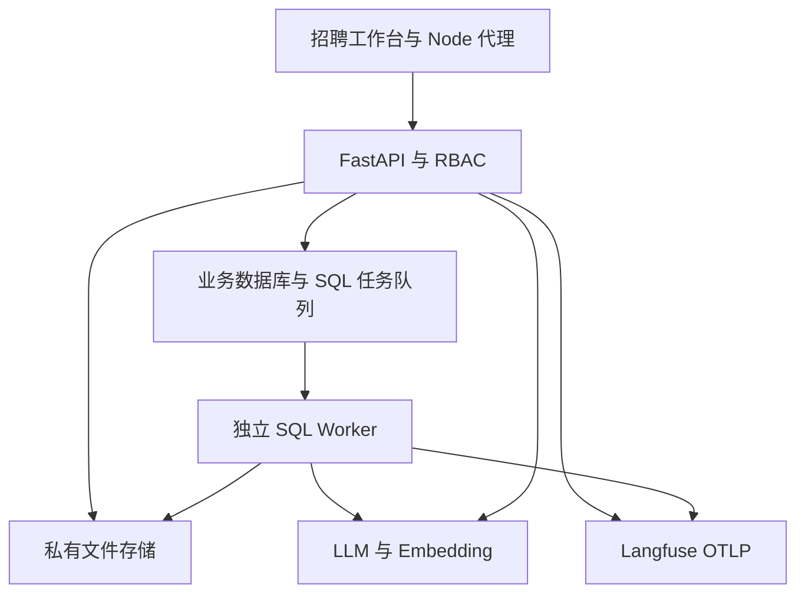
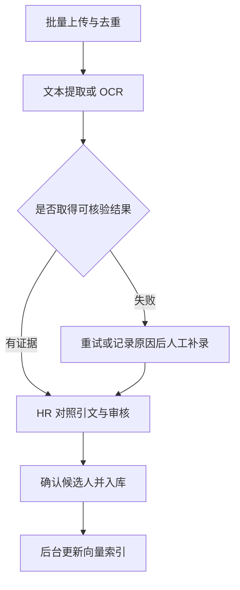

# AI 数字化人才平台

面向一家虚构跨境服装企业的内部招聘工作台。演示情景以 Amazon 美国站运营岗位为例，覆盖招聘专员、面试官和系统管理员。示例候选人和评估资料均为合成数据。

简历来自多种文档格式，人工整理耗时，结构化字段也容易失去原文出处。岗位、简历和面试记录分散时，招聘团队难以追踪候选人状态、复核事实和回答制度问题。平台把招聘记录、带引文的 AI 输出和人工确认放在同一业务流程中。

## 核心功能

| 模块 | 当前实现 |
| --- | --- |
| 招聘工作台 | 岗位、人才库、应聘关联、面试安排、反馈与招聘状态流转，使用 JWT、角色权限和审计记录 |
| 简历解析 Workflow | 批量提交、文件去重、文本提取、结构化输出、证据校验、后台重试和独立索引任务 |
| 人才检索 Agent | 在授权范围内按岗位过滤，执行关键词与向量混合召回，使用 RRF 融合和规则重排，返回简历引文 |
| RAG 知识库 | 文档上传、版本管理、召回与引用校验，问答依据已授权资料 |
| 面试辅助 Agent | 从已审核的岗位要求和简历证据生成提纲。面试官可查看提纲并填写面试反馈 |
| ChatAI 主控 Agent | 保存会话与恢复结果，改写查询并通过模型选择受限的只读工具，返回 SSE 事件 |
| 人机协同 HITL | HR 对照原文编辑证据、处理解析失败并确认入库。招聘状态由有权限的人员操作 |

## 系统架构



| 技术层 | 轻量开发模式 | Compose 目标模式 |
| --- | --- | --- |
| 后端与迁移 | Python、FastAPI、SQLAlchemy、Alembic、JWT | 同一套业务代码和迁移 |
| 前端 | HTML、CSS、原生 ES Modules、Node 同源代理 | 独立 Web 容器 |
| 数据与向量 | SQLite、JSON 向量 | PostgreSQL、pgvector |
| 文件 | 本机私有磁盘 | MinIO 私有桶 |
| 调度 | 独立 SQL worker，数据库持久化任务及租约 | 同一 worker，Redis 保留为部署依赖及就绪检查 |
| AI | 本机 Ollama 已用 Qwen 和 BGE 实测 | 环境配置符合接口契约的模型 |

早期设计记录在 [需求基线](docs/requirements.md) 和 [首版设计](docs/superpowers/specs/2026-11-10-talent-platform-design.md)。本阶段沿用已运行的 Python 显式编排、SQL worker 和原生前端。队列状态与业务事务写入同一个数据库，两套模式使用同样的领取与恢复逻辑。Celery、Vue 和首版其他存储方案作为历史设计保留。当前实现见 [架构说明](docs/03_系统架构设计说明书.md)。

## 智能简历解析与审核



上传时保存原件并生成后台任务。Worker 将 OCR、模型调用及证据验证结果写回草稿。结构化字段须关联实际原文，HR 可编辑后确认。只有当前有效、已审核的候选人资料参与检索。

## 目录结构

| 路径 | 内容 |
| --- | --- |
| `backend/app/modules/` | 招聘 API、RAG、检索、面试助手和 ChatAI |
| `backend/app/ai_resume/` | 文档提取、结构化证据和异步解析／索引任务 |
| `backend/app/core/` | 模型、权限、嵌入、检索与遥测封装 |
| `backend/alembic/` | SQLite 和 PostgreSQL 数据库迁移 |
| `frontend/`、`infra/` | 前端、代理和镜像定义 |
| `datasets/synthetic/`、`scripts/` | 合成数据、初始化、冒烟、压测和评估 |
| `tests/`、`docs/` | 回归测试和中文项目文档 |

## 两种运行模式

### Docker Compose

前提是 Docker Desktop 的 Linux 引擎可访问。需要 Python 执行密钥生成脚本，需事先安装 cryptography。

```powershell
python scripts/setup_env.py --profile compose
docker info
docker compose config --quiet
docker compose up -d --build
docker compose exec api python -m backend.app.cli seed
```

已有通过脚本生成的本地 .env 可直接用于 Compose，文件中的数据库、Redis 和 MinIO 端点由 Compose 覆盖。生成脚本不会覆盖既有文件。种子命令面向开发和验证，仅创建缺失的账号与带模拟标记的业务数据。非演示初始化使用 CLI 的 create-admin 命令。

- Web 默认 [127.0.0.1:5173](http://127.0.0.1:5173)
- OpenAPI UI [127.0.0.1:18000/docs](http://127.0.0.1:18000/docs)
- 就绪检查 [127.0.0.1:18000/health/ready](http://127.0.0.1:18000/health/ready)
- PostgreSQL 15432、Redis 16379、MinIO 19000，MinIO 管理台 19001

API 容器先迁移数据库，再初始化私有对象桶。Compose 验收要求健康检查同时显示 PostgreSQL、pgvector、Redis 和 MinIO 为 ok。

### Windows 本地开发

在没有可访问的 Docker 引擎时，可使用真实 SQLite 数据库及私有磁盘文件目录验证招聘业务。只绑定本机回环地址。就绪检查明确返回 local_only。

```powershell
python -m pip install -r requirements-core.txt -r requirements-test.txt
python scripts/setup_env.py --profile local
python -m backend.app.cli migrate
python -m backend.app.cli seed
python -m uvicorn backend.app.main:app --host 127.0.0.1 --port 18000 --no-access-log
```

另开两个终端，在项目根目录分别运行 `node frontend/server.mjs` 和 `python -m backend.app.ai_resume.worker`。本地数据库和附件存于 .runtime。切换 Compose 使用独立数据库，演示数据可重新初始化。PDF 和图片解析需要 `requirements-resume.txt` 中的依赖。扫描 PDF 和图片还需要 PATH 中的 Tesseract 及 `chi_sim+eng` 语言包。

## 简历解析与模型

HR 的敏感简历权限可打开简历解析。创建批次后逐份提交文件，任务由独立 worker 领取。刷新批次可查看解析和索引状态。审核页可对照文字、下载原件、编辑证据、确认新建或关联候选人。解析失败时可重试，或填写原因并人工入库。原有候选人的敏感原件也可从候选人详情送去解析。

本地默认保留提取、人工审核及基于词项的混合检索。启用模型后，可以按批次授权结构化提取和 Embedding，按知识文档版本授权 RAG。招聘助手调用模型完成改写和只读工具选择，前端接收 SSE 进度及结构化结果。更新模型配置后重新启动 API 和 worker。

可使用本地 Ollama，示例配置写在本机 `.env`，模型需提前下载。

```dotenv
TALENT_EXTERNAL_AI_ENABLED=true
TALENT_MODEL_URL=http://127.0.0.1:11434/v1
TALENT_MODEL_API_KEY=ollama-local-placeholder
TALENT_CHAT_MODEL=qwen2.5:7b
TALENT_EMBEDDING_MODEL=bge-m3:latest
TALENT_MODEL_TIMEOUT_SECONDS=95
```

如需真实 Langfuse 观测，设置 HTTPS 的 `TALENT_LANGFUSE_URL`、`TALENT_LANGFUSE_PUBLIC_KEY` 和 `TALENT_LANGFUSE_SECRET_KEY`。用任务 Trace ID 对照解析和索引节点。平台发送状态、耗时、模型版本和用量等字段。

## 演示账号

- hr — 招聘专员，具备联系方式、敏感简历读取和重开终态授权。
- hr_standard — 普通招聘专员。
- interviewer — 面试官，初始种子只分配了一条应聘记录。
- admin — 系统管理员，可维护用户及审计。

密码取本机 .env 的 TALENT_DEMO_PASSWORD。测试资料样例可使用 datasets/synthetic/resume-amazon-us.txt。

## 验证

```powershell
python -m pytest -q -p no:cacheprovider tests
python -m alembic check
npm.cmd --prefix frontend run check
python scripts/smoke_phase_one.py
python scripts/smoke_resume.py
python scripts/smoke_resume.py --real-model
python scripts/smoke_assistant.py
python scripts/benchmark_recruitment.py
# 正式 Compose 依赖验收
python scripts/smoke_phase_one.py --require-compose
```

冒烟脚本通过 Web 代理访问正在运行的 API，写入明确标记的合成验收记录。DeepEval 验收需要安装 `requirements-eval.txt`，配置评审模型后执行 `python scripts/evaluate_recruitment.py --judge-model <模型标识>`。阶段进度与当前问题记录在 [11_开发进度与问题记录.md](docs/11_开发进度与问题记录.md)。

## 可观测性、评估与验收状态

| 项目 | 实测或待验收范围 |
| --- | --- |
| 招聘业务与 AI | 本地通过招聘闭环、任务重试、原文审核、向量检索、RAG、面试提纲和 ChatAI 工具调用。真实模型验收使用本机 Ollama 和合成数据 |
| 自动化测试 | Windows 环境 42 项通过、5 项跳过，涉及 PDFium 和真实 Tesseract OCR 的测试需要环境依赖 |
| Langfuse | OTLP 输出和脱敏字段通过测例。真实项目接收需部署环境配置凭据 |
| DeepEval | RAG 忠实度与相关性的评估入口已提交。评审模型和依赖就绪后执行真实评估 |
| Compose | 静态配置与 PostgreSQL 迁移 SQL 已验证。Docker Desktop Linux 引擎访问受限，待验真实 PostgreSQL、pgvector、Redis、MinIO |

开发记录中的指标均来自注明的本地合成测试环境。
