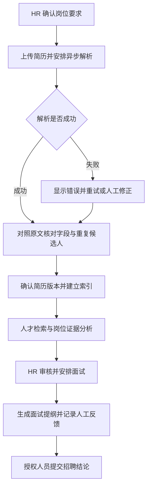

# 业务流程与术语指南

> 第一阶段确认规则：已录用、未录用、候选人放弃可由具备额外授权的 HR 填写原因重新开启为待审核，并清除旧面试指派。关岗阻止新增应聘，已有非终态应聘可继续处理，或由 HR 人工终止、转人才储备。面试反馈由已指派面试官提交。

v0.1 · 待评审

## 端到端流程

批量上传按文件独立处理，部分失败不影响同一批次的成功文件。原始附件、解析草稿、已确认简历和索引任务分开追踪。索引失败不会撤回已确认资料，页面显示索引状态并提供受控重试。解析失败时允许重传或由 HR 录入，人工录入字段标记其来源。

## 状态规则

| 当前状态 | 授权操作及目标 |
| --- | --- |
| 已收录 | HR 提交至待审核 |
| 待审核 | HR 通过至待面试，或转人才储备、未录用、候选人放弃 |
| 待面试 | 指派的面试官或 HR 开始面试，进入面试中。HR 可退回待审核，或记录候选人放弃 |
| 面试中 | 指派的面试官提交反馈后进入待人工决策。HR 可按实际情况记录候选人放弃 |
| 待人工决策 | HR 提交已录用、未录用、候选人放弃、人才储备，或发起复面回到待面试 |
| 人才储备 | HR 填写理由重新进入待审核 |
| 已录用、未录用、候选人放弃 | 授权 HR 填写原因后可重开至待审核，并清除旧指派 |

每次变更记录操作者、前后状态、时间、原因。业务负责人提供岗位要求和面试意见。岗位关闭后停止新增应聘，已有应聘可继续处理或人工结案，关闭动作要求审计。

## 术语

| 术语 | 含义 |
| --- | --- |
| 候选人 | 人员主体，与简历及岗位应聘记录分别管理 |
| 应聘记录 | 候选人与岗位的独立流程，绑定当时使用的简历版本 |
| 简历证据 | 来自指定原文版本的定位片段，代表材料中有这段表述 |
| 未找到证据 | 当前材料未提及或未定位到相关内容，可生成待确认问题 |
| Listing | 亚马逊商品详情页及其标题、属性、文案等运营对象 |
| ACOS / ROAS | 广告花费 ÷ 广告归因销售额 / 广告归因销售额 ÷ 广告花费 |
| CTR / CPC | 点击量 ÷ 展示量 / 广告花费 ÷ 点击量 |
| FBA | 亚马逊提供的仓储与订单履约服务 |