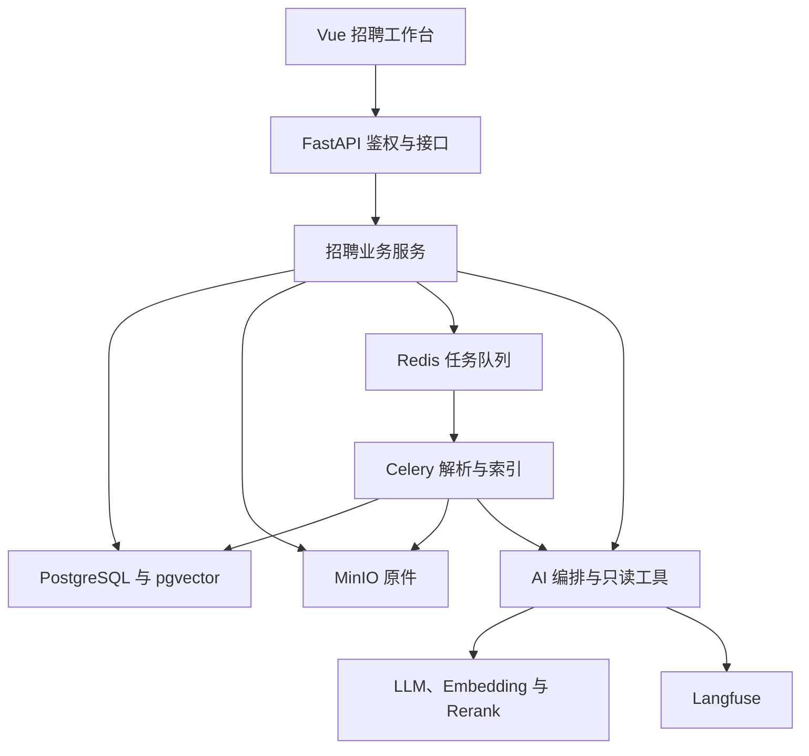

# 系统架构设计说明书

> 恢复开发后的实现采用独立 SQL worker，由数据库原子提交业务与任务，使用租约和条件写回处理重复领取及中断恢复。SQLite 本地模式及 PostgreSQL Compose 模式复用队列协议。Redis 保留在 Compose 依赖就绪检查。PostgreSQL 的简历 Embedding 使用原生 pgvector 列，本地使用 SQLite JSON。当前检索在授权范围内计算精确相似度，结果与关键词排名进行 RRF 合并后按词项覆盖度和相似度重排。运行结果见 [进度记录](11_开发进度与问题记录.md)。

> 第一阶段实际实现：FastAPI、SQLAlchemy、Alembic 与 Node 静态 Web 及同源代理。Windows 本地替代模式使用 SQLite 和本地文件，只用于开发联调。Vue、队列 worker、向量检索和 AI 执行层属于后续选型或交付，当前实现与验收见 [进度记录](11_开发进度与问题记录.md)。

v0.1 · 待评审



API 层负责协议、校验、授权入口，业务层负责权限、状态流转和事务，数据层落实查询范围和唯一约束。Agent 只能通过类型化工具调用业务读服务，调用身份由服务端注入。API 与 worker 共享模型、业务服务和迁移。数据库事务内记录业务变更和待投递任务，独立调度器投递 Redis，重复投递通过任务幂等键、租约和写回条件收敛。

## 选型

| 领域 | 方案和理由 |
| --- | --- |
| Web | Vue 3、TypeScript、Vite、Element Plus、Pinia。先用表格展示统计，只有图形确实便于识别趋势时采用 ECharts |
| API | FastAPI、Pydantic、JWT；按角色权限和数据范围检查，接口可生成 OpenAPI |
| 持久化 | PostgreSQL、SQLAlchemy 2.x、Alembic、pgvector，使权限过滤、业务数据和向量可在同一数据库处理 |
| 检索 | 简历和知识库独立表。中文分词后建立关键词索引，首版在授权范围内用精确余弦搜索。用召回率与负载验证 HNSW 的引入价值 |
| 任务与文件 | Celery + Redis 处理耗时解析、OCR、索引和清理。DB 保存状态与错误，MinIO 存原件。容器内运行 OCR 和 worker |
| AI | 单一模型适配层，模型须支持结构化输出和工具调用。简单流程用 Python 服务，动态分支与工具回合需要时用 LangGraph。避免并行引入多个 Agent 执行器 |
| 观测与评估 | Langfuse 采集白名单字段，DeepEval 结合固定数据和确定性断言 |
| 部署 | Compose 管理 Web、API、worker、调度和依赖。容器优先验证 Python 3.12，精确版本在依赖试跑后锁定 |

## ric-train 复用

已读本地 education 分支提交 1ff2e71 的 Base 相关实现和依赖；本轮未运行或导入脚手架。

| 代码 | 观察和决策 |
| --- | --- |
| Base/Ai/base/baseLlm.py | 封装 OpenAI 客户端、同步与异步调用、流式接口及模型能力声明。借鉴模型适配接口，补充 Schema、用量、超时和结构化错误契约 |
| Base/Ai/base/baseAgent.py | 提供工具注册、同步与异步循环、上下文和中间件，含可变会话记忆。参考执行结果和中间件边界，在本项目按请求持有上下文 |
| Base/Api/ai/chatApi.py | 已有审核、改写、记忆、持久化、SSE，依赖 Qwen 具体类和既有会话／向量服务。参考步骤顺序，平台自身绑定登录主体和招聘权限 |
| Base/Repository/base/baseDBModel.py | 基于 Pydantic 与连接抽象，含运行时建表和补列逻辑。复用 CRUD 组织经验，落地用 SQLAlchemy 会话和 Alembic 迁移 |
| Base/Config/setting.py | 按组件拆分配置，根目录配置同时覆盖 MySQL、Redis、Milvus 等。参考分组方式，仅声明人才平台需要的配置 |
| 根 main.py | 是开发用数据库执行示例。招聘数据仅从类型化业务接口访问 |

首选参考设计并独立实现适配。若评审决定直接引入部分源码，先核对授权、依赖边界和运行方式。检查时未发现根目录 LICENSE 文件。

## 拟定目录

```text
docs/
backend/app/
  api/  core/  db/
  modules/          # jobs, candidates, resumes, applications, interviews, knowledge, chat
  ai/               # models, prompts, workflow, agents, tools, retrieval, tracing
  tasks/
backend/alembic/
frontend/src/
  api/  router/  stores/  views/  components/
infra/
datasets/synthetic/
evals/
tests/
compose.yaml
.env.example
README.md
```

参考：[pgvector](https://github.com/pgvector/pgvector)、[Celery Redis](https://docs.celeryq.dev/en/stable/getting-started/backends-and-brokers/redis.html)、[Langfuse Masking](https://langfuse.com/docs/observability/features/masking)。
