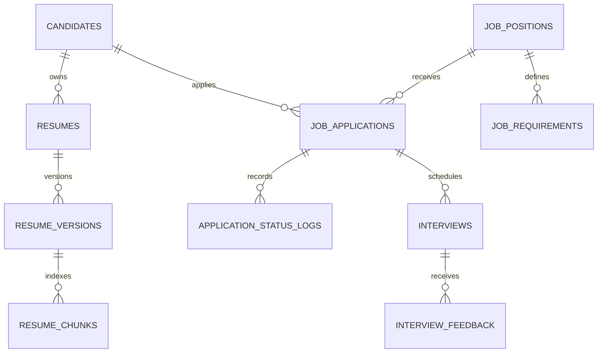

# 数据库设计说明书

> 第一阶段物理模型以 backend/alembic/versions 中的 0001_phase_one 迁移为准。三种角色与两项额外授权固化在 users，login_sessions 支持撤销 JWT，联系方式加密存于 candidate_contacts，原件元数据存于 resume_files。job_applications 按岗位与候选人唯一，application_status_logs 保存人工原因，interview_feedback 保存面试记录。后续阶段将扩展简历版本、岗位修订、向量及会话数据。

v0.1 · 待评审。以下为逻辑模型，物理 DDL 由评审通过后的迁移实现。

## 表、约束与读路径

默认 UUID 主键，时间为 timestamptz，业务表含 created_at 和 updated_at。流水表追加写。业务状态以枚举或 CHECK 约束实现，并由服务验证合法转移。

| 表 | 主关联、约束及索引 |
| --- | --- |
| users、roles、permissions | 用户登录名、角色码、权限码分别唯一。user_roles、role_permissions 以双外键组成唯一键 |
| job_positions、job_access_grants | 岗位含负责人、部门名、状态和版本号。在招列表索引 status 与 updated_at。授权表按 job_id、user_id 和范围唯一 |
| job_requirements | job_id 外键，按岗位和要求版本保存不可变快照，job_id、revision、ordinal 唯一 |
| candidates、candidate_contacts | 联系方式单独加密，使用带密钥摘要做授权范围内的候选重复提示。联系方式允许多人使用，提示交由 HR 确认 |
| files、resume_uploads | 原件记录对象键、SHA-256、类型和字节数。对象键唯一，哈希用于复用已存在文件。上传记录追踪批次、权限、草稿、来源和解析状态，同一文件允许关联合法独立上传 |
| resumes、resume_versions | resume 归候选人，版本归 resume，resume_id 与 version_no 唯一。版本含文件、确认状态、原文定位映射和索引状态。有效版本由外键指针确定，并验证归属 |
| candidate_skills、work_experiences、project_experiences、education_experiences | 归确认版本。含规范化值及证据引用。技能索引 normalized_name 与 version_id。证书、意向、摘要先存版本内 JSONB |
| job_applications | candidate_id、job_id、resume_version_id 外键，每个候选人和岗位组合一条流程。绑定版本必须属于该候选人。以 job_id、status、updated_at 支撑看板，用 version 做乐观锁 |
| application_status_logs | application_id、actor_id、旧状态、新状态、原因和发生时间。按 application_id、created_at 查历史 |
| evidence_analyses | 关联应聘、简历版本和岗位要求修订，保存结果、提示词版本与人工审核状态。允许多次分析并查询历史 |
| interviews、interview_questions、interview_feedback | interview 归应聘，application_id、round_no 唯一。记录指派人、面试官、时间和状态。问题保存难度、考察点、引用和人工版。反馈按 interview_id、interviewer_id 唯一，修订写审计 |
| knowledge_bases、knowledge_documents、document_versions | 知识库含访问角色范围，文档与版本一对多，文档只有一个生效版本 |
| resume_chunks、document_chunks | 对应版本外键，按 version_id、ordinal、embedding_revision 唯一。含脱敏检索文本、定位、关键词索引、向量和版本。查询命中仅限已确认且当前生效材料 |
| chat_sessions、chat_messages | 会话归用户，消息归会话，session_id、seq 唯一。保存摘要、角色、会话范围、引用及完成状态 |
| async_tasks | 包含任务类型、幂等键、重试次数、租约令牌、下次执行时间及安全错误码。type 与 dedupe_key 唯一，按 status 与 next_run_at 调度 |
| agent_runs、prompt_versions、audit_logs | 运行记录含 trace_id、业务引用、模型及执行状态。提示词按 key 与 revision 唯一。审计保存操作者、动作、安全对象 ID、时间及原因 |
| candidate_notes | candidate_id 和作者外键，按人才库权限读取，禁止进入检索向量和模型上下文 |

## 一致性和数据生命周期

- 人工确认事务更新版本、持久化经历与证据并插入索引任务。索引完成前保留可查询的已确认结构化数据。切换版本后旧切片立即从搜索可见范围移除。
- 流转事务同时验证授权、预期版本、目标状态和反馈条件，写入状态、流水和审计。重复请求按主体、接口与幂等键复用结果，载荷不同返回冲突。
- 删除先标记并撤销读权，后台幂等清除对象、切片、草稿、业务派生材料和缓存。共享原件按引用计数与复核回收，避免误删仍使用的版本。备份以批准的周期淘汰。审计只保留最小必要的操作记录。
- 索引写回前验证版本仍生效、未删除且租约仍有效。附件访问经应用鉴权，使用受控短时下载。保留期限可配置，由企业确认具体值。
- 排序和全文检索参数采用白名单。权威过滤落在对象查询，向量缓存按权限范围及版本隔离。首版使用 GIN 关键词索引、B-tree 业务索引与精确向量检索。