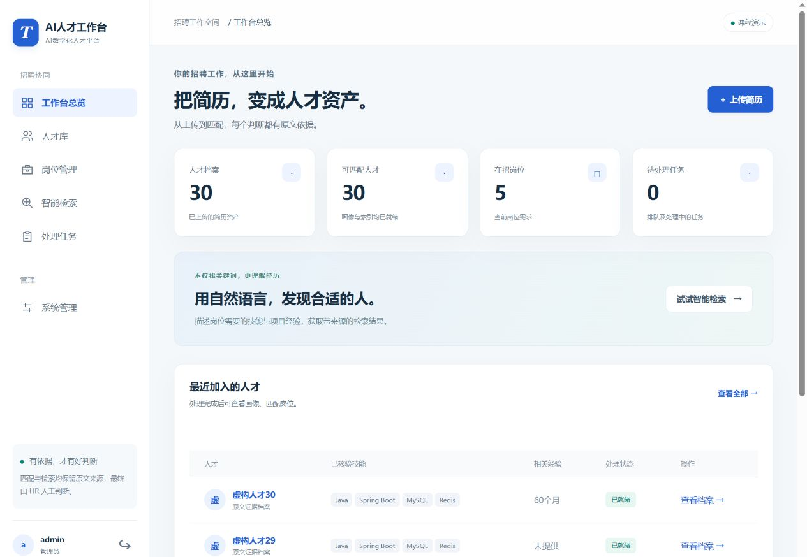

# 测试与验收报告

日期：2026-11-10（Asia/Shanghai）。整体业务质量验收：**未通过**。应用与Docker部署可运行，核心确定性测试通过；真实RAG稳定性、端到端召回和性能仍有未达标项。PR保持草稿，不等同于用户已验收。

## 实测结果

| 项目 | 原定目标 | 实际结果 | 结论 |
| --- | --- | --- | --- |
| 确定性自动化 | 完整套件通过 | 70 passed（含18项真实服务集成） | 通过 |
| Linux/Python3.11 | 镜像内单元通过 | 52 passed，18项集成另在本机执行 | 通过 |
| 样例就绪 | 30简历、5JD | 30简历／5JD全部READY，期间发生超时和重试 | 通过，非首次全成功 |
| 字段精确准确率 | ≥90% | 165/180 = 91.67% | 通过 |
| 岗位Precision@3 | ≥80% | 100.00% | 通过 |
| 双向评分一致 | 相同人才岗位分数相同 | 5/5对一致 | 通过 |
| 端到端RAG Recall@5 | ≥80% | 56.67% | 未通过 |
| 无答案问题拒答 | 不编造 | 5/5 = 100% | 通过 |
| 返回引用可定位 | 100% | 34/34条原文可定位 | 通过 |
| RAG时延 | ≤30秒 | 中位数20.86秒，最大111.30秒；7/15次超目标 | 未通过 |
| 单份简历完成 | ≤120秒 | 当前成功任务中位数35.50秒，最大414.00秒 | 未全部通过 |
| 容器异步新上传 | 入队≤3秒，完成≤120秒 | 上传0.2秒，12.3秒READY；原文307下载 | 通过 |

## 数据和指标口径

- 30份虚构中文PDF、5个岗位JD、15个问题，标注在模型运行前冻结。未为实现修改标注或降低阈值。
- 六个事实字段逐项精确比较，共180项；字符串仅规范化NFKC、空白和大小写，数组比较集合，不删改标点或字段措辞。按原文件映射人才，避免姓名提取错误影响样本归属。
- 每个JD在eligible组取前三名，分母固定3；五个JD平均Precision@3。未知硬条件独立进入needs_review；明确经验不足排除。
- 十个可回答问题计算端到端Recall@5，相关人每题6名；HTTP失败按0，不用成功样本重新归一化。五个无答案问题单独统计拒答。
- 检索层另做不调用生成模型的诊断，Recall@5=81.67%；此结果只用于定位故障边界，**不替代端到端56.67%的未通过结论**。
- 首个完整导入批次22/30就绪、8次超时；经过正常重试后30份全部就绪。报告字段准确率来自最终当前版本，不冒充首次成功率。当前版本成功任务耗时不含排队及前面失败尝试；旧版本及失败日志保留在本机运行记录。
- 这是小型合成演示验证集，不能据此宣称真实企业招聘的泛化效果。

## 首次端到端失败和恢复

| 问题 | 状态 | 错误 | 秒数 |
| --- | --- | --- | --- |
| 谁做过招聘API服务项目？ | 503 | MODEL_UNAVAILABLE | 90.33 |
| 谁能从用户数据中提炼结论并制作可视化报表？ | 502 | MODEL_FORMAT_ERROR | 111.3 |
| 谁做过订单服务系统项目？ | 502 | MODEL_FORMAT_ERROR | 110.71 |

针对失败项的独立恢复验证：已测3项，恢复1项。详见 [恢复记录](RAG失败项恢复验证.json)，不覆盖首次15题结果。

## 兼容性与原因边界

本机10Router 1.6.2→Spark-X2.6路径接受关闭思考参数，但64token探测仍返回reasoning_content而正文为空。该证据说明当前路径不能保证关闭思考，不足以单独断定问题发生在网关还是上游。未修改用户现有全局网关设置，保留指定Spark-X2.6。
LangChain会改写max_tokens为max_completion_tokens；1token对照表明网关同时执行两个限制，排除“令牌参数完全被忽略”的假设。只读短原文对照35.77秒仍未达到30秒；较大输出预算单次成功但只用了699token，不据此盲目归因或覆盖原失败记录。
结构化格式和引用最多一次受控修复；仍不成立返回502，服务或超时错误返回503，不返回假答案。模型慢请求可能使整体耗时超过单次90秒。

## 真实组件与浏览器验证

- MySQL8.0.27专用业务／测试库隔离；迁移0002成功；中文全文LONGTEXT真实读写通过。
- BGE-M3返回有效1024维向量；Milvus切片、画像和岗位集合及Neo4j技能图均实际写入、查询；当前版本在Top-K前过滤，结果仍回查SQL。
- Redis实际负责队列、缓存、注销和限流；MinIO实际保存原文，业务桶与向量库内部对象存储分开。
- Linux RQ真实上传DOCX、云提取、索引、签名下载、测试档案软归档验证通过。Web/worker使用同一个镜像；镜像不含.env。
- 浏览器验证登录、30/30人才就绪和5JD统计、双向匹配、原文展开、备注保存、真实RAG来源、系统七项连接状态。1280桌面与375窄屏均有截图，窄屏无整页横向溢出。
- 整分支独立审阅五项Important均先RED再GREEN，修复证据见独立审阅记录；无Critical。

## 执行命令和证据

```powershell
$env:PYTEST_DISABLE_PLUGIN_AUTOLOAD='1'
.\.venv\Scripts\python.exe -m pytest -q -p no:cacheprovider
.\.venv\Scripts\python.exe -m scripts.真实模型验收
.\.venv\Scripts\python.exe -m scripts.生成验收报告
docker compose ps
```

[环境及向量模型摘要](验收环境.json) · [真实模型原始结果](真实模型验收结果.json) · [检索层诊断](检索层诊断结果.json) · [容器异步证据](容器异步验收结果.json) · [测试用例](测试用例与执行记录.md) · [独立审阅](独立审阅记录.md) · [未通过项](验收问题清单.md)



## 交付判断

需求、设计、计划、代码、确定性测试、Docker、中文手册和验收材料已形成。简历画像与岗位匹配适合当前课程演示；RAG真实质量和性能尚不能标记整体通过。后续按问题清单解决同一模型通道的稳定性和输出兼容性，再以原标注及原目标完整复验。
